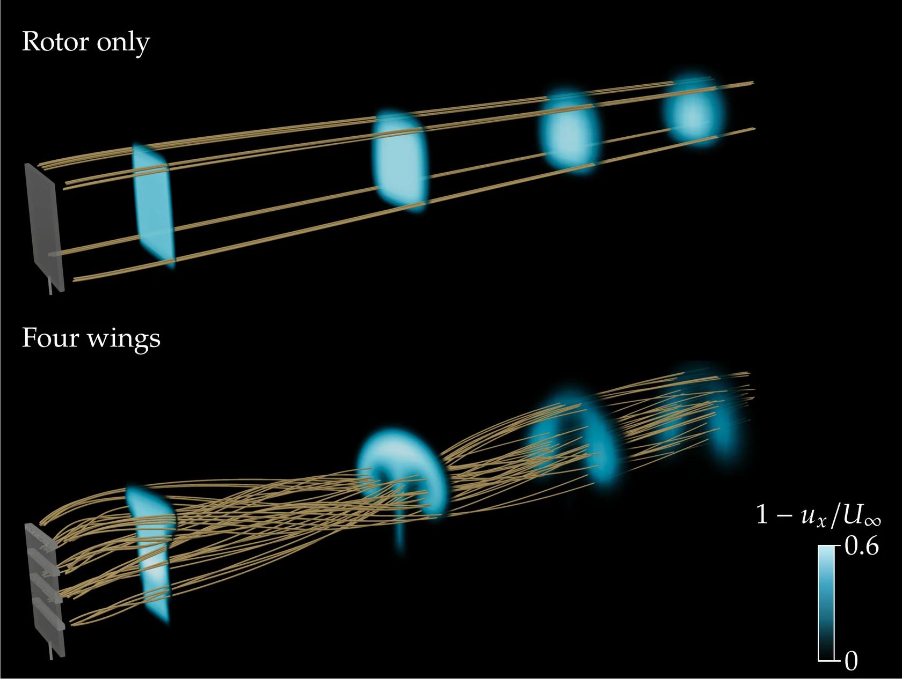

# OpenFOAM actuator surface

**Rotors and wings as momentum sources in OpenFOAM.**



An OpenFOAM case representing rotor thrust and lift-producing surfaces through coded momentum sources. Cell selections define actuator regions; force vectors set their loading.

## Quick start

The original target is **OpenFOAM Foundation v9**, with MPI and a working C++ build environment. The coded source compiles at runtime.

```bash
git clone https://github.com/EngFlavioMartins/openfoam-actuator-surface.git
cd openfoam-actuator-surface
foamVersion
```

Start in a fresh clone with OpenFOAM loaded. Review the forces in [Solver/ActuatorsSetup](Solver/ActuatorsSetup) and the cell selections in [Solver/system/topoSetDict](Solver/system/topoSetDict).

The shipped configuration requests **eight processes** in `Solver/system/decomposeParDict`. Adjust the subdomain count and hierarchical decomposition together if required.

```bash
bash Solver/Allprepare.sh
sh Solver/Allrun.sh
```

Preparation restores the supplied initial fields and mesh, selects actuator cells and decomposes the case. The run script executes `simpleFoam`, reconstructs the latest solution and exports VTK. These scripts modify the working case; use a fresh clone or copy when preserving previous results.

## Configure a case

| File | Controls |
| --- | --- |
| `Solver/ActuatorsSetup` | `RotorForce` and `BladeForce` vectors |
| `Solver/system/topoSetDict` | Rotor and wing cell selections |
| `Solver/constant/fvOptions` | Coded momentum-source distribution |
| `Solver/system/controlDict` | Solver and output settings |
| `Solver/system/decomposeParDict` | Parallel decomposition |
| `Resources/` | Alternative layouts and force notebook |

The setup uses direct force vectors. F = ½ρAU∞²C can be used when preparing a load, but coefficients are not read automatically from a separate interface.

## Batch studies

[run-all-cases.sh](run-all-cases.sh) sequences rotor-only and one-, two- and four-wing configurations, including no-drag variants. It invokes cleanup and replaces settings between runs. Review it before starting; saved studies are copied to `Results/`.

The notebooks are optional post-processing resources. Header artwork is a conceptual interpretation of actuator forcing and vortex transport, not a simulated velocity field.

## Scope

The original dictionaries and source terms are preserved and target the OpenFOAM Foundation releases. The OpenFOAM v2412 port below was run for the rotor-only and four-wing layouts.

## Citing

This code accompanies F. A. C. Martins, A. van Zuijlen and C. S. Ferreira (2025), Proof of concept for multirotor systems with vortex-generating modes for regenerative wind energy, *Wind Energy Science* 10, 41–58, [doi:10.5194/wes-10-41-2025](https://doi.org/10.5194/wes-10-41-2025). Code record: [Zenodo, 10.5281/zenodo.11615669](https://doi.org/10.5281/zenodo.11615669).

GitHub's *Cite this repository* button uses [CITATION.cff](CITATION.cff).

## Contributing and licence

See [CONTRIBUTING.md](CONTRIBUTING.md). Maintained by [Flavio Martins](https://engflaviomartins.github.io/).

The existing [Apache 2.0 licence](LICENSE.txt) is unchanged.

## OpenFOAM v2412 port and website render

`cases/openfoam-v2412/` holds a port of the case to OpenFOAM v2412 (openfoam.com).

- **What changes:** `prepare_case.sh` copies `Solver/` and replaces `momentumTransport` with `turbulenceProperties`. It also rewrites the coded momentum source in v2412 syntax, which reads the `Rotor` and `Blade` cell zones written by `topoSet`.
- **What stays the same:** the mesh, initial fields, schemes and source distribution.
- **Running it:** `run_case.sh` runs `topoSet`, `decomposePar`, `simpleFoam` and `reconstructPar`.

```bash
bash cases/openfoam-v2412/prepare_case.sh Resources/Setup-no-blades Resources/topoSetDict-OneBlade runs/case0B
bash cases/openfoam-v2412/prepare_case.sh Resources/Setup-with-blades Resources/topoSetDict-FourBlades runs/case4B
bash cases/openfoam-v2412/run_case.sh runs/case0B 5
bash cases/openfoam-v2412/run_case.sh runs/case4B 5
pvpython scripts/render/render_wake_slices.py runs/case4B outputs/render/wake-4B.png
```

Both cases converge within 300 iterations. `scripts/render/` holds the ParaView script for the website image: streamwise velocity on cross-flow planes and streamlines from the actuator ends.
