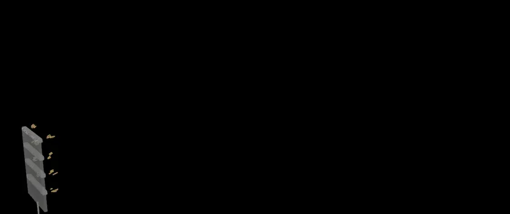

# OpenFOAM actuator surface

<p align="center">
  <a href="https://doi.org/10.5194/wes-10-41-2025"></a>
  <a href="https://doi.org/10.5281/zenodo.11615669"></a>
  <a href="https://www.openfoam.com/"></a>
  <a href="https://github.com/EngFlavioMartins/openfoam-actuator-surface/blob/HEAD/LICENSE.txt"></a>
  <a href="https://engflaviomartins.github.io/#regenerative-wakes"></a>
</p>

**Rotors and wings as momentum sources in OpenFOAM.**

<p align="center"></p>

A rotor and lift-producing wing strips are modelled as momentum sources on selected cells, so wakes can be studied without resolving the blades. The original case (`Solver/`) targets the OpenFOAM Foundation releases; `cases/openfoam-v2412/` runs it on OpenFOAM v2412 (openfoam.com).

## Run it

```bash
git clone https://github.com/EngFlavioMartins/openfoam-actuator-surface.git
cd openfoam-actuator-surface
python run.py
```

`run.py` prepares the four-wing case in `runs/four-wing` and, if OpenFOAM is installed and loaded, runs it (about 15 minutes on 5 cores); otherwise it tells you the one command to run once OpenFOAM is there. The first time, it installs what it needs into a private `.venv` folder (a minute or so); after that it starts at once. All you need is Python 3.10 or newer (and OpenFOAM to run the case).

<details>
<summary>Prefer conda?</summary>

```bash
conda env create -f environment.yml
conda activate openfoam-actuator-surface
python examples/quick_start.py
```

</details>

**Next:** Use `Resources/Setup-no-blades` for the rotor alone. Forces are set in `Resources/Setup-*` and the actuator cells in `Resources/topoSetDict-*`; each run converges in under 300 iterations.

## Figure and animation

<p align="center"></p>

The rotor alone (top) and with four wing strips (bottom): with the wings, the wake rises and recovers faster.

```bash
sh scripts/render/make_figure.sh runs/rotor-only runs/four-wing          # the figure
python scripts/render/make_animation.py runs/four-wing   # the animation at the top
```

Both need [ParaView](https://www.paraview.org/download/) and finished runs; the figure also needs LaTeX.

## Cite

This code accompanies the paper below. If you use it, please cite (code record: [Zenodo, 10.5281/zenodo.11615669](https://doi.org/10.5281/zenodo.11615669)):

```bibtex
@article{martins2025multirotor,
  author  = {Martins, Flavio A. C. and van Zuijlen, A. and Ferreira, C. S.},
  title   = {Proof of Concept for Multirotor Systems with Vortex-Generating Modes for Regenerative Wind Energy: A Study Based on Numerical Simulations and Experimental Data},
  journal = {Wind Energy Science},
  volume  = {10},
  pages   = {41--58},
  year    = {2025},
  doi     = {10.5194/wes-10-41-2025}
}
```

GitHub's **Cite this repository** button (from [CITATION.cff](CITATION.cff)) gives the same reference in other formats.

## Licence

[Apache 2.0](LICENSE.txt): you are free to use, change and share this code, also commercially. If you pass it on, keep the [NOTICE](NOTICE) file with it; it says where the code comes from and how to cite it.
