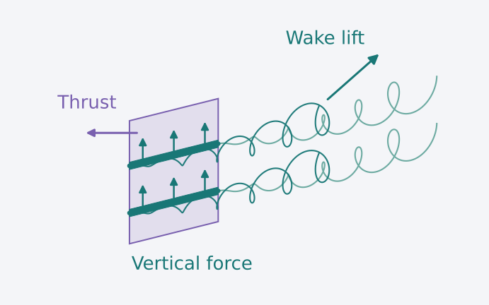

# OpenFOAM actuator surface



An OpenFOAM case representing rotor thrust and lift-producing surfaces through coded momentum sources. Cell selections define actuator regions; force vectors set their loading.

## Quick start

The original target is **OpenFOAM Foundation v9**, with MPI and a working C++ build environment. The coded source compiles at runtime.

```bash
git clone https://github.com/EngFlavioMartins/openfoam-actuator-surface.git
cd openfoam-actuator-surface
foamVersion
```

Start in a fresh clone with OpenFOAM loaded. Review the forces in [Solver/ActuatorsSetup](Solver/ActuatorsSetup) and the cell selections in [Solver/system/topoSetDict](Solver/system/topoSetDict).

The shipped configuration requests **eight processes** in `Solver/system/decomposeParDict`. Adjust the subdomain count and hierarchical decomposition together if required.

```bash
bash Solver/Allprepare.sh
sh Solver/Allrun.sh
```

Preparation restores the supplied initial fields and mesh, selects actuator cells and decomposes the case. The run script executes `simpleFoam`, reconstructs the latest solution and exports VTK. These scripts modify the working case; use a fresh clone or copy when preserving previous results.

## Configure a case

| File | Controls |
| --- | --- |
| `Solver/ActuatorsSetup` | `RotorForce` and `BladeForce` vectors |
| `Solver/system/topoSetDict` | Rotor and wing cell selections |
| `Solver/constant/fvOptions` | Coded momentum-source distribution |
| `Solver/system/controlDict` | Solver and output settings |
| `Solver/system/decomposeParDict` | Parallel decomposition |
| `Resources/` | Alternative layouts and force notebook |

The setup uses direct force vectors. F = ½ρAU∞²C can be used when preparing a load, but coefficients are not read automatically from a separate interface.

## Batch studies

[run-all-cases.sh](run-all-cases.sh) sequences rotor-only and one-, two- and four-wing configurations, including no-drag variants. It invokes cleanup and replaces settings between runs. Review it before starting; saved studies are copied to `Results/`.

The notebooks are optional post-processing resources. Header artwork is a conceptual interpretation of actuator forcing and vortex transport, not a simulated velocity field.

## Scope and citation

The original dictionaries and source terms are preserved. Compatibility with other OpenFOAM distributions has not been established; this presentation update does not claim a fresh OpenFOAM run.

Code record: [Zenodo, 10.5281/zenodo.11615669](https://doi.org/10.5281/zenodo.11615669). Related research: [Regenerative multirotor wakes](https://doi.org/10.5194/wes-10-41-2025).

## Contributing and licence

See [CONTRIBUTING.md](CONTRIBUTING.md). Maintained by [Flavio Martins](https://engflaviomartins.github.io/).

The existing [Apache 2.0 licence](LICENSE.txt) is unchanged.
